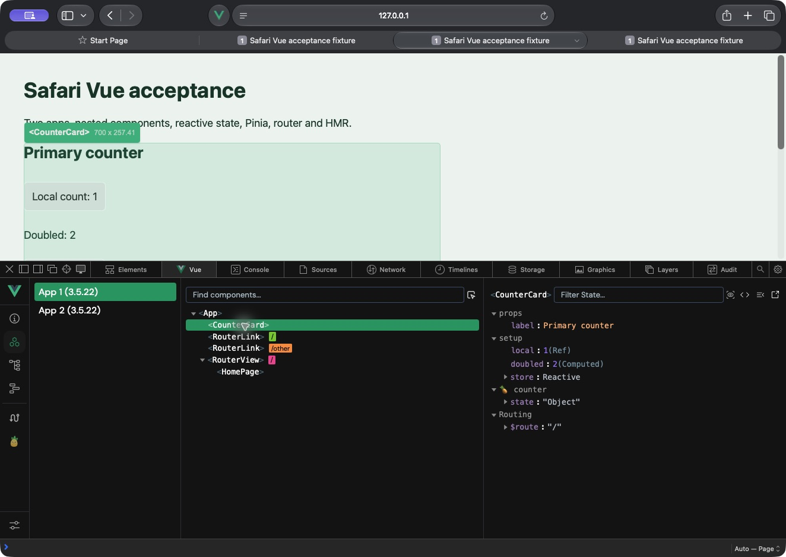

# Install the development preview

**Safari removes temporary extensions after 24 hours or when Safari quits.** Verified on Safari 27.0.1/macOS 27.0.1; older versions are unverified.

## Ready ZIP: no build tools needed

1. Download the versioned ZIP from the project release when available and extract it. The selected folder must contain `manifest.json`.
2. Safari > Settings > Advanced: enable **Show features for web developers** if you choose to use this unsigned development preview.
3. Settings > Developer > **Add Temporary Extension…**: select the extracted folder. Enter any requested macOS authentication privately in the system dialog.
4. Settings > Extensions: enable **Vue & Nuxt Devtools for Safari**, and allow only development sites you intend to inspect.
5. Reload your Vue development page, then Develop > Show Web Inspector > **Vue**.

Safari also accepts a ZIP directly according to Apple's documentation; this project's native test used an extracted folder. Repeat step 3 after expiry or Safari quit. No Node, Xcode, certificates or Apple membership are needed for temporary loading.



For Nuxt, use its embedded DevTools toggle or Shift+Option+D for server-backed tools. The Safari Vue panel provides component inspection separately.

## Troubleshooting

| Symptom | Action |
|---|---|
| No Developer tab | Enable Show features for web developers in Advanced. |
| Empty panel / unavailable connection | Confirm site access, reload the page and reopen Web Inspector so the hook captures Vue mounting. |
| Permissions changed | Close the inspector, reload the page and reopen it. Denied sessions fail closed. |
| Updated files do not appear | Settings > Extensions > Reload, then reload and reopen. Use Show in Finder to confirm the loaded folder. |
| Extension disappeared | Repeat temporary installation; expiry is 24 hours or Safari quit. |
| Production app missing | Vue must expose its devtools hook; the CSP fixture explicitly enables production devtools. |

Safari grants by hostname: a 127.0.0.1 grant covers its ports. Keep unrelated sites at Ask.

## Build from source

Use Node 22.19+, 24.11+ or 26+, Git and pnpm 10.18.3. Python 3 is needed only for release ZIP packaging, Xcode only for the optional native container. Safari 18.4+ is an unverified compatibility target. Upstream commits and dependency lockfiles are pinned.

```
npm run build
npm test
npm run package:release
npm ci --prefix fixtures/vue
npm ci --prefix fixtures/nuxt
npm run build --prefix fixtures/vue
npm run dev --prefix fixtures/vue
npm run dev --prefix fixtures/nuxt
```

Run the two fixture development commands in separate terminals. For the optional native project, run `npm run package:macos` with Xcode installed.

For Safari 27 temporary development installation, enable Settings > Advanced > Show features for web developers, then Settings > Developer > Add Temporary Extension and select `dist/extension`. Safari may require authentication for unsigned extensions; complete that system dialog yourself. Enable only this extension and grant permission only to the fixture sites you intend to inspect. These actions require your approval; this session used the user-approved temporary installation and one-day loopback permission. Safari removes temporary installations on quit or after 24 hours.

Open `http://127.0.0.1:5173`, then Develop > Show Web Inspector > Vue. If Vue mounted before the extension gained site permission, reload the page so the document_start hook can capture app initialization. For Nuxt use `http://127.0.0.1:3000` and its embedded DevTools button (or Shift+Option+D) for server-backed tools. The extension's Vue panel is a separate component inspector; Nuxt server RPC stays in the development server.

After rebuilding an installed temporary extension, use Settings > Extensions > Reload, then reload the fixture and reopen Web Inspector. The /csp acceptance route requires a Vue fixture build first.

The generated Xcode project under `dist/macos` also builds the macOS containing app with `CODE_SIGNING_ALLOWED=NO`. This unsigned app is a developer testing container, not a signed/notarized Gatekeeper-trusted installer. Its current deployment target is macOS 27. It is not offered as a normal persistent installer.

Persistent distribution outside the Mac App Store requires a Developer ID signed containing app/extension and app notarization, with Apple Developer Program access and signing/notarization authorization. App Store distribution requires submission/review. No certificates, credentials, signing identity, enrollment or submission are created or used here. Do not bypass Gatekeeper warnings.

Official Apple instructions: [temporary loading](https://developer.apple.com/documentation/safariservices/running-your-safari-web-extension), [distribution options](https://developer.apple.com/documentation/safariservices/distributing-your-safari-web-extension).
